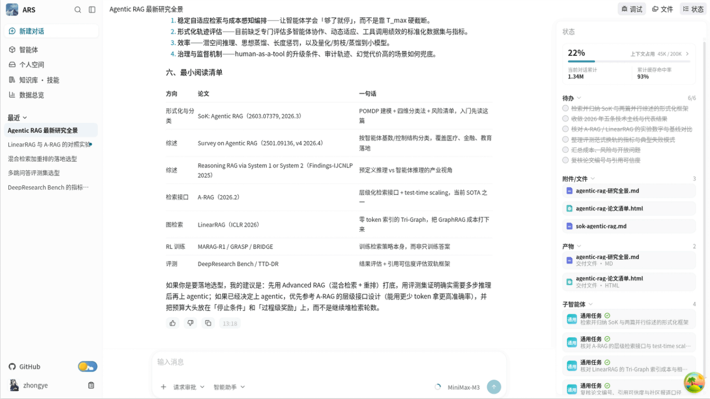
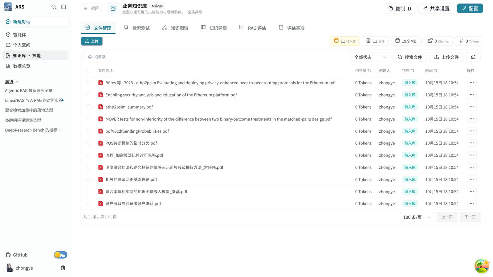
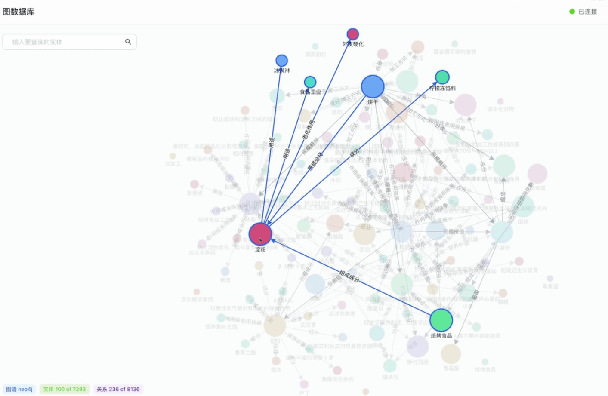
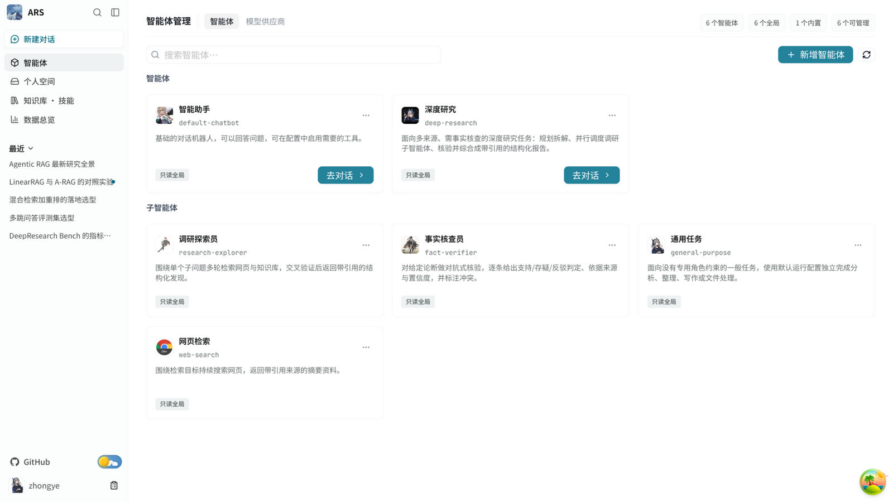
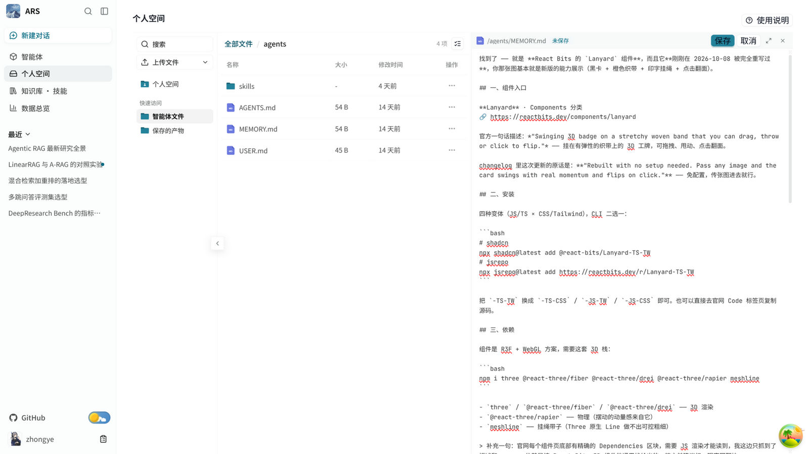
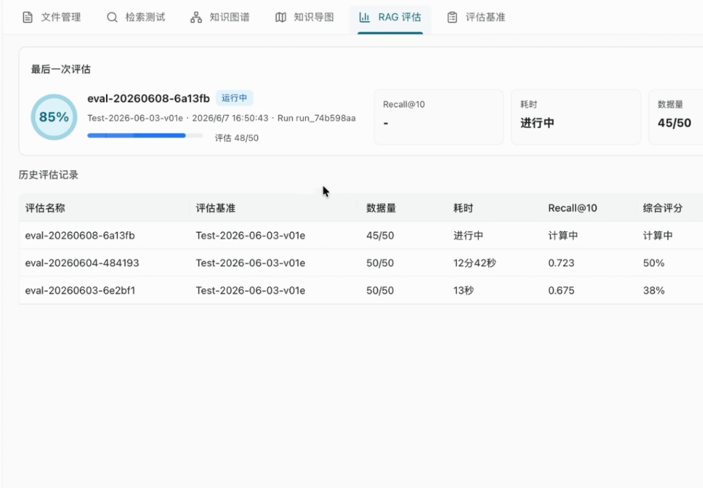

# KnowAgenticRAG

**可私有部署的多租户知识智能体平台。** 知识库与 RAG、知识图谱、LangGraph 多智能体、MCP / Skills、沙盒工具与权限管理跑在同一个工作区里。文档、会话与执行轨迹留在自己的基础设施上，模型接哪家、谁能用哪些能力由管理员划定。

[项目主页](https://zhongye1.github.io/KnowAgenticRAG/) · [快速开始](https://zhongye1.github.io/KnowAgenticRAG/intro/quick-start) · [文档](https://zhongye1.github.io/KnowAgenticRAG/intro/project-overview) · [版本变更记录](https://zhongye1.github.io/KnowAgenticRAG/develop-guides/changelog)

[DeepWiki](https://deepwiki.com/Zhongye1/KnowAgenticRAG)

[](#许可证)
[](https://github.com/Zhongye1/KnowAgenticRAG)
[](backend/pyproject.toml)
[](web/package.json)
[](docker-compose.yml)

## KnowAgenticRAG 能做什么

给需要自己掌握数据、模型与权限的团队，尤其是要私有部署的多用户 Agent 场景：

Harness：提供功能完善的云端多用户 Harness，自定义智能体，沉淀企业轨迹。
Knowledge： 提供高效、精准的 Agentic RAG 套件，上传文档，解析、分块和向量索引。
执行多步骤任务：提供组合工具、MCP、Skills、子智能体和沙盒，产出可预览、可下载的文件。
知识图谱：支持从 Milvus 知识库的文档块中抽取实体和关系，写入 Neo4j 并参与检索。
管理团队使用范围：支持按用户、部门和共享范围管理知识库、智能体、Skills 和模型。
评估运行质量：支持评估知识库的检索结果，也可以用 Langfuse Dataset 评估完整智能体任务。

## 快速启动

基于 Docker 启动，服务和中间件主要包括：LangGraph、React、FastAPI、Milvus、Neo4j、PostgreSQL、MinerU、PaddleOCR

### 前置条件

安装 Docker Engine 与 Docker Compose，并准备一个可用的大模型 API Key（初始化脚本按 `.env.template` 读取，默认是硅基流动的 `SILICONFLOW_API_KEY`）。PDF / Office / 图片的解析还需要 `MINERU_API_KEY`。

### 1. 获取代码并初始化

```bash
git clone --depth 1 https://github.com/Zhongye1/KnowAgenticRAG.git
cd KnowAgenticRAG

# Linux/macOS
./scripts/init.sh

# Windows PowerShell
.\scripts\init.ps1
```

初始化脚本会创建 `.env`、读取模型 API Key，并为 JWT、API Key 派生与 Sandbox provisioner 分别生成独立的安全密钥。也可以手动复制 `.env.template` 填写这些值；三个安全密钥必须各自独立，并在后续重建与升级中保持原值。

### 2. 启动开发环境

```bash
docker compose up --build -d
```

首次启动需要构建镜像并等 `storage-migrator` 成功。查看服务状态：

```bash
docker compose ps
curl --fail http://localhost:5050/api/system/ready
```

`status` 为 `ready` 后，打开 http://localhost:5173，按页面提示初始化超级管理员并登录。

| 入口       | 地址                                    |
| ---------- | --------------------------------------- |
| Web        | http://localhost:5173                   |
| API 文档   | http://localhost:5050/docs              |
| 进程存活   | http://localhost:5050/api/system/health |
| 接流量就绪 | http://localhost:5050/api/system/ready  |

`health` 只表示 API 进程活着，`ready` 只表示接流量条件成立，两者都不代表登录、对话、知识库或 Agent Run 的业务链路正确。

不需要知识库与知识图谱时，用 LITE 模式起最小栈（只启动 `postgres redis minio api worker`）：

```bash
task up-lite
```

从更早的部署升级到当前版本不能直接 `docker compose up`：停机窗口、备份、数据迁移与回滚步骤只在[生产部署](https://zhongye1.github.io/KnowAgenticRAG/advanced/deployment)中维护，升级前请完整阅读。

## 文档导航

- [项目介绍](https://zhongye1.github.io/KnowAgenticRAG/intro/project-overview)：能力、概念与系统边界。
- [快速开始](https://zhongye1.github.io/KnowAgenticRAG/intro/quick-start)：从零启动本地环境。
- [模型配置](https://zhongye1.github.io/KnowAgenticRAG/intro/model-config)：接入聊天、嵌入与重排模型。
- [知识库与知识图谱](https://zhongye1.github.io/KnowAgenticRAG/intro/knowledge-base)：创建知识库并验证检索。
- [智能体开发](https://zhongye1.github.io/KnowAgenticRAG/agents/agents-config)：配置 Agent、工具、Skills、MCP 与子智能体。
- [机制详解](https://zhongye1.github.io/KnowAgenticRAG/mechanisms/)：沙盒、上下文压缩与知识库的运行机制。
- [生产部署](https://zhongye1.github.io/KnowAgenticRAG/advanced/deployment)：部署、升级、备份与排障。
- [版本变更记录](https://zhongye1.github.io/KnowAgenticRAG/develop-guides/changelog)：查看已发布变更。

## 能力展示

从资料进系统到任务出结果，都在同一条链路上发生。下面按七个模块说明这条链路提供了什么：

| 模块           | 解决的问题                     | 代表能力                                                         |
| -------------- | ------------------------------ | ---------------------------------------------------------------- |
| 工作台         | 一次提问就能看清执行到了哪一步 | 会话、引用来源、执行状态、上下文用量、子智能体、交付文件         |
| 知识库与 RAG   | 让回答有据可查                 | 多格式解析、语义切分、向量与图谱双索引、混合召回与重排、来源引用 |
| 知识图谱       | 把文档里的关系用起来           | 实体关系抽取、按 schema 建图、同名实体合并、子图浏览、图谱检索   |
| 多智能体与扩展 | 让复杂任务有人分工             | 主智能体与 SubAgents、Skills、MCP、工具、中间件                  |
| 沙盒与产物     | 让结果落地成文件               | 隔离执行、持久 Workdir、浏览器内预览、文件下载                   |
| 评估           | 让每次调整有指标               | 召回率与 MRR、忠实度与引用准确性、Langfuse Dataset 智能体评估    |
| 团队治理       | 让多人共用有边界               | 三级角色、共享范围、模型与 API Key 配置、会话审计、任务中心      |

### 01 · 工作台

一次提问里同时拿到三样东西：检索到的依据、执行到了哪一步、以及最后的产物。任务拆解、子智能体线程、上下文用量与交付文件都在同一个界面，不用切系统。

- `@` 直接引入知识库、个人文件或某个 Skill。
- 执行过程按步骤展开，工具调用、状态变化与上下文 Token 消耗逐项可见。
- 生成的文档、表格与页面就地预览或下载。



### 02 · 知识库与 RAG

上传之后是一条自动流水线：解析、语义切分、向量化入 Milvus，需要图谱时再抽实体与关系。检索阶段向量与 BM25 双路召回，重排后把最相关的片段交给模型，回答里的来源可以点回原文。

- 文件与目录集中管理，解析进度、分块与 Token 统计随时可查。
- Embedding 与 Rerank 模型可选可换，知识库详情页里就能做多路召回测试。
- 片段带来源标识，按 `file_id` 回到原文核对。



### 03 · 知识图谱

文档入库时顺手把实体和关系抽出来：按 schema 约束建图、同名实体自动合并，图数据落在 Neo4j 与 PostgreSQL，实体与三元组另有 Milvus 语义索引；检索时图谱召回与向量命中融合。

- 实体按关键词可搜，节点属性可查，关联子图可展开浏览。
- 抽取与索引在知识库详情页配置，失败样例直接看得到。
- 图谱结果与文档来源可相互定位。



### 04 · 多智能体与扩展生态

每个 Agent 有自己的模型、提示词、知识挂载与工具集。遇到需要拆分的任务，主智能体规划，SubAgents 并行执行；能力不够时再加 Skills、MCP 服务器或自定义工具。

- Agent 配置覆盖基座模型、知识库、工具与系统提示词。
- SubAgents 可并行处理调研、数据分析或内容生成。
- Skills 与 MCP 按任务加载，个人技能与共享技能分开管理。



### 05 · 沙盒与产物

读写文件与执行脚本都发生在隔离容器里，工具能碰到的路径由沙盒边界限定，虚拟路径与宿主机路径不混用。产物落到持久 Workdir，浏览器里直接能看。

- 文件操作与命令执行在沙盒内完成，宿主目录不暴露给模型。
- 产出可以是 Markdown 报告、数据表格、HTML 页面或代码。
- 文本、表格、图片与 PDF 在浏览器内预览，原始文件可下载。



### 06 · 评估

调检索参数或换模型之后，用两组指标判断进退：知识库侧看检索与生成质量，智能体侧看完整任务的表现。

- 检索看召回率、命中率与 MRR，生成看忠实度、相关性与引用准确性。
- 评估基准可上传或生成，跑批与历史结果留在页面上。
- 智能体任务用 Langfuse Dataset 评估，覆盖研究、编程、文件处理等多步骤场景。



### 07 · 团队治理

多人共用一套平台时，能力与数据都要有边界：角色决定能做什么，共享范围决定能看见谁的知识库与 Agent。

- 超级管理员、管理员与普通用户三级角色；会话与文件按账号隔离。
- 知识库、Agent 与 Skills 按全局、部门或个人范围共享，可只读也可管理。
- 模型凭据与 API Key 集中配置，会话审计与任务中心在同一条运维入口下。

## 本地开发与验证

```bash
task verify        # 工程契约静态校验 + 其自测
task web:verify    # 前端 lint、单测、设计 token、分层、契约漂移、构建
```

```bash
docker compose exec api uv run --group test pytest test/unit -m "not slow"
docker compose exec api uv run --group test pytest test/integration
docker compose exec api uv run --group test pytest test/e2e -m e2e
```

- 前端宿主机开发：`task web:dev`，或 `cd web && pnpm install && pnpm run dev`。浏览器只访问同源 `/api/*` 与 `/minio/*`（开发由 vite 代理，生产由反向代理转发），前端代码里没有后端地址配置。
- 接口契约变更：`task web:api` 刷新快照并重新生成客户端，两个产物都入库。
- 日常容器命令：`task ps` / `task logs` / `task shell` / `task down`；`task reset` 会删除数据卷，是破坏性操作。
- 系统边界、目录职责与主链路见 [ARCHITECTURE.md](ARCHITECTURE.md)；测试分层与最低证据要求见[测试规范](https://zhongye1.github.io/KnowAgenticRAG/develop-guides/testing-guidelines)；非平凡改动必须在同一变更里新增或更新一份[决策记录](docs/develop-guides/decisions/README.md)。

## 许可证

按 `backend/pyproject.toml` 与 `packages/ars-cli/pyproject.toml` 的声明，本项目采用 MIT 许可证。Compose 引入的 Neo4j、Silo、Milvus、etcd、Redis 等第三方组件保留各自原始许可证，部署与再分发的边界见[生产部署](https://zhongye1.github.io/KnowAgenticRAG/advanced/deployment)的「第三方组件与许可证」一节。
